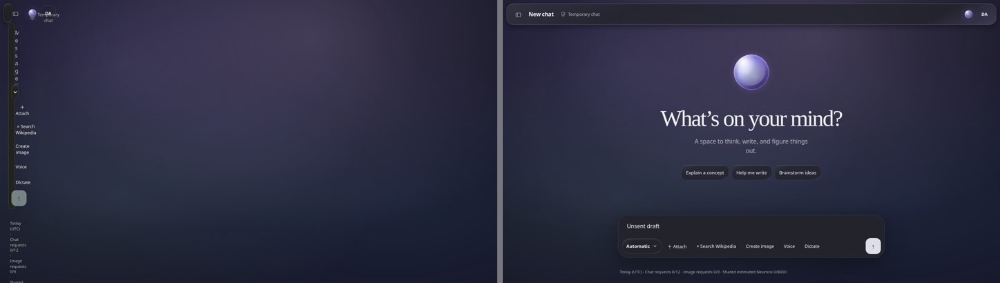
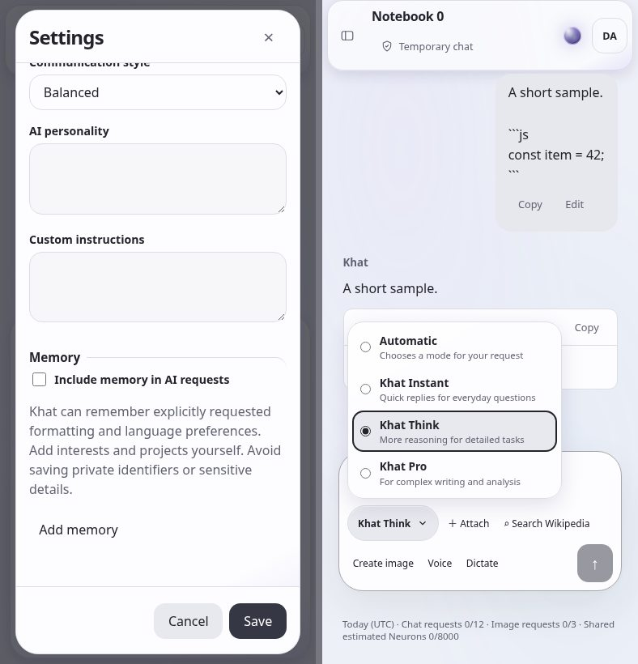

# Final craftsmanship update

## Sidebar root cause

Desktop CSS defined two grid tracks, with a zero-width sidebar track when collapsed. The sidebar also used `display: none`, removing it from grid auto-placement. The main chat then occupied the first track and measured 0 px at 768, 1024, 1280, and 1440 px. Mobile used a different layout.

The desktop grid now explicitly places the sidebar in the first track and chat in the second, flexible track. Collapsing hides the sidebar visually and from interaction, and the second track expands immediately. Only sidebar opacity and transform animate. The same chat and composer DOM remain mounted, so toggling keeps the conversation and draft.

## Interface

The model menu uses native radio controls for arrow-key navigation and exposes localized descriptions. The selection still goes through the existing model preference and API request. Settings uses a fixed header and footer around one independently scrollable content region. Graphite theme tokens now use cool neutrals, with existing accent presets and custom colors preserved.

## Verification

Run the local fixture with `KHAT_CHROMIUM_PATH=/usr/bin/chromium node scripts/check-craftsmanship.mjs`. Set `KHAT_CAPTURE_DIR` to save screenshots. Chromium covered 390, 768, 1024, 1280, and 1440 px, with light and dark appearances, repeat toggling, draft and conversation preservation, Temporary Chat, switching models by pointer and keyboard, a pending chat request and its streamed reply, and Settings scrolling, Cancel and Save. Chat uses a fixture response and consumes no inference quota.

Playwright WebKit downloaded but could not launch on the Linux host because required system libraries are missing. Native Safari and iOS were not tested.

### Chromium captures

1440 px sidebar collapse, before and after

390 px Settings scrolled to the bottom and model menu open

