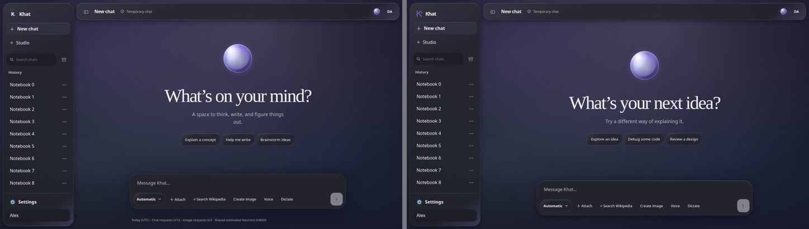
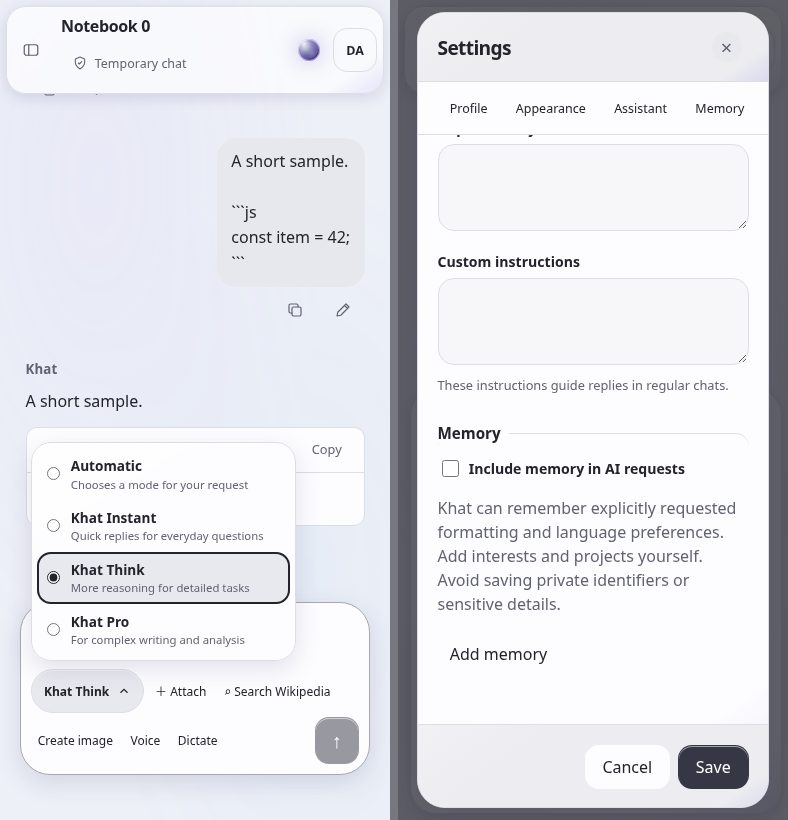

# Khat final product release candidate

## Product changes

New registrations require a nickname or preferred display name, saved atomically with account creation. Existing accounts with no display name complete a one-time prompt, and the name is editable in Settings. Existing account-scoped D1 preferences continue to inform regular chat. The earlier bug was that display name was used only in the UI and instructions were treated as optional reference data. Temporary Chat skips stored personalization and memory and does not save its conversation. This describes Khat storage only.

Welcome content uses 30 heading pairs, 25 subtitle pairs and ten editable prompt pairs in Danish and English. It rotates on fresh chats, avoids immediate repeats and sometimes uses a local-time greeting with the saved display name. Temporary Chat greetings and suggestions do not read the profile or memory.

The interface has an original mark and favicon, a lighter sidebar, compact icon actions below user bubbles, a section jump bar in Settings, and reusable glass depth tokens. Retrieved citation numbers link to their sources. Unmatched citation numbers are suppressed in rendered answers. Markdown code remains intact.

## Models and usage

Automatic uses the existing complexity routing, with Qwen3 30B ahead of Granite for simple requests when the interface language is set to Danish. The reservation check still gates every attempt and Automatic can try a lower-cost candidate. Instant remains Granite 4.0 H Micro, Think is GLM 4.7 Flash, and Pro is Gemma 4 26B. Llama 3.3 remains available as an existing fallback. Studio retains FLUX.1 Schnell and the existing prompt and image safety checks. The official model catalog and pricing pages were checked. The routing change is a candidate for live evaluation, rather than evidence that Qwen gives better Danish.

Cloudflare documents 10,000 free Neurons per day. Khat retains its shared, atomic cutoff at 8,000 estimated Neurons. The old 12 text and 3 image allowances were registration defaults stored per account. New accounts start at 24 and 5. Existing limits are preserved because an administrator may have chosen them, and Administration can adjust each account up to 35 and 8. Settings shows remaining requests and shared estimated usage, with threshold warnings remaining in chat. Inference limits are independent of saved history.

[Cloudflare model catalog](https://developers.cloudflare.com/workers-ai/models/) · [Cloudflare pricing](https://developers.cloudflare.com/workers-ai/platform/pricing/)

## Verification and limitations

- Chromium layout coverage at 390, 768, 1024, 1280 and 1440 px.
- Settings Chromium profile on a busy shared runner recorded one workspace read at startup, no writes during slider movement and one write on Save. The sample measured 2,716 ms of Chromium task time during the synthetic interaction. It does not establish device frame rate or a before/after speedup.
- Native Safari and iOS remain unverified. Local AI and speech fixtures do not establish live answer quality or microphone behavior on physical devices. No live Cloudflare inference credentials were available for the requested Danish comparative evaluation or Studio output verification.
- The current Studio quality and aspect-ratio behavior are inherited. This change does not add provider-side quality controls or optical refraction. Settings section navigation covers Profile, Appearance, Assistant and Memory, with usage and privacy information in the scroll body. Composer tools remain separate accessible controls.
- No new Cloudflare binding, migration or paid service is required.

### Desktop before and after

### Mobile model menu and Settings

