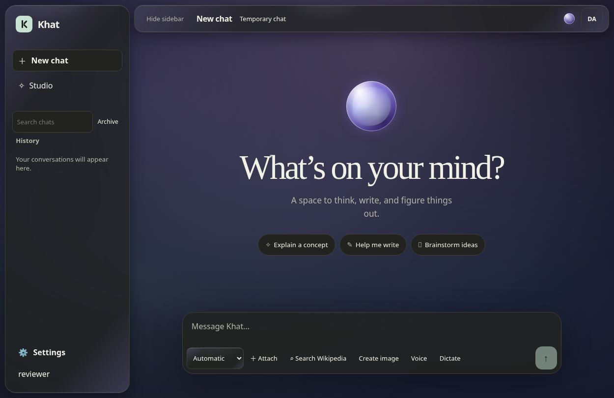

# Khat Liquid Intelligence 3.0

## Review the visual changes

These captures use the same empty workspace and a local test account fixture. The motion demo shows the sidebar, Voice panel, message-to-Studio routing, and appearance change. It makes no model requests and captures no microphone audio.

| Layout | Before | After |
| --- | --- | --- |
| Desktop, light | [1250 × 810](liquid-media/before-desktop-light.jpg) | [1250 × 810](liquid-media/after-desktop-light.jpg) |
| Desktop, dark | [1250 × 810](liquid-media/before-desktop-dark.jpg) | [1250 × 810](liquid-media/after-desktop-dark.jpg) |
| Mobile, light | [390 × 844](liquid-media/before-mobile-light.jpg) | [390 × 844](liquid-media/after-mobile-light.jpg) |
| Mobile, dark | [390 × 844](liquid-media/before-mobile-dark.jpg) | [390 × 844](liquid-media/after-mobile-dark.jpg) |

[Watch the six-second motion demo](liquid-media/motion-demo.mp4)

## Model choices

Verified against Cloudflare's official model pages and pricing on November 26, 2026. The table compares published capabilities and prices with the needs of the four Khat modes. Relative latency, mathematical accuracy, coding quality, and Danish and English quality still need live controlled tests. Khat makes no benchmark or independent verification claim.

| Route | Selection | Capability and cost tradeoff |
| --- | --- | --- |
| Instant | [Granite 4.0 H Micro](https://developers.cloudflare.com/workers-ai/models/granite-4.0-h-micro/) | 131k context. Cloudflare describes an efficient instruction-following model suited to edge workloads. At 1,542 / 10,158 Neurons per million input / output tokens, this is the least expensive primary route. Deep mathematical and coding questions go to Think. |
| Think | [GLM-4.7-Flash](https://developers.cloudflare.com/workers-ai/models/glm-4.7-flash/) | 131,072 context, documented reasoning and streaming. At 5,500 / 36,400, suitable for carefully scoped reasoning and coding. [GPT-OSS 20B](https://developers.cloudflare.com/workers-ai/models/gpt-oss-20b/) is another supported reasoning option with lower output but higher input prices. |
| Pro | [Gemma 4 26B A4B IT](https://developers.cloudflare.com/workers-ai/models/gemma-4-26b-a4b-it/) | 256k published model context, documented reasoning and vision, at 9,091 / 27,273. Khat caps the submitted context well below this window to fit its allowance. Works as the dedicated route for screened image questions. |
| Auto | Server-side ordered candidates | Classifies by latest prompt and submitted context size. Cheap candidates handle short routine prompts. Auto retries eligible models when a provider fails before streaming or an estimate cannot be reserved. The model name shown on the response is the route that actually started streaming. |

The retired defaults [Llama 3.1 8B FP8](https://developers.cloudflare.com/workers-ai/models/llama-3.1-8b-instruct-fp8/) and [Qwen3 30B FP8](https://developers.cloudflare.com/workers-ai/models/qwen3-30b-a3b-fp8/) are marked deprecated in the model pages. Their explicit compatibility routes are best-effort. The existing [Llama 3.3 70B Fast](https://developers.cloudflare.com/workers-ai/models/llama-3.3-70b-instruct-fp8-fast/) remains a fallback and is more expensive at 26,668 / 204,805. Nemotron 3 Super is deprecated. Higher-priced options that require a paid billing method are excluded. [Cloudflare Workers AI pricing and billing-method list](https://developers.cloudflare.com/workers-ai/platform/pricing/)

## Implementation details and limits

- The Worker keeps recent turns verbatim and selects at most four short excerpts from older submitted turns by keyword relevance. This is extractive context compression. It uses no separate model call. Existing opt-in D1 memories stay owner-scoped with a bounded relevance filter. Temporary chats skip memory and history persistence.
- A bounded parser checks standalone arithmetic using basic operators and parentheses. It supplies a calculated reference to the model, with approximate floating-point precision. It does not evaluate user code or verify external claims. Search remains Wikipedia-backed and uses numbered links to the retrieved sources.
- Server-side SSE filtering removes structured reasoning fields and suppresses split private thinking tags. It emits only answer deltas. Abrupt stream failure can be retried with the composer or regenerate action. Khat cannot guarantee that a provider will never return private reasoning as untagged public text.
- Studio uses [FLUX.1 Schnell](https://developers.cloudflare.com/workers-ai/models/flux-1-schnell/) with 2, 4, and 8 documented diffusion steps. Landscape and portrait selections add composition guidance and crop locally, including 16:9 and 9:16. The enhancement toggle adds a bounded composition instruction without a second generation call. Regenerate uses the original prompt with the currently selected settings. Prompt and rendered image screening remain in place.
- Studio routing recognizes explicit English and Danish image-generation phrases in the composer. It opens the prefilled Studio dialog for confirmation. A temporary chat opens a private one-image preview with no gallery write. Standard images retain the existing owner-scoped compact history. [FLUX.2 Klein 4B](https://developers.cloudflare.com/workers-ai/models/flux-2-klein-4b/) has a separate editing contract and higher output tile costs. Image editing is outside this release.
- Attach one JPEG, PNG, or WebP to ask Gemma 4 about it. The browser removes original metadata through JPEG re-encoding, and the Worker bounds the bytes and dimensions and screens the image before inference. Chat history stores only the attachment name. The image cannot be reused by regeneration unless reattached.
- Liquid Glass uses layered gradients, adaptive tint, optional backdrop blur, and pointer-tracked highlights. SVG displacement is a decorative refraction layer where supported. Surfaces remain solid and readable with basic CSS fallbacks. Voice starts only from explicit interaction. The meter uses local time-domain and frequency samples. Browser speech synthesis does not expose its waveform, so the speaking animation follows genuine speech events. Recognition and speech availability vary by device.
- Visual controls are saved per account with live previews and a visual reset. The atmosphere pauses on hidden tabs and sits still during conversations. Reduced motion disables animation and the optional microphone visualization. Khat keeps the shared password gate, session format, rate limits, user authorization, and existing D1 schema.
- Usage shows actual reservation counts for the signed-in account and clearly labeled shared estimated Neurons. Global cutoffs remain 35 text, 8 image, and 8,000 estimated Neurons per UTC day. Cloudflare Free provides 10,000 Neurons per day per account. Khat does not enable billing or report Cloudflare account balance. [Workers AI free allocation](https://developers.cloudflare.com/workers-ai/platform/pricing/)

## Verification and release

Run `npm test -- --run`, `npm run check`, and `npm run test:accounts -- --browser` on Node.js 22+. The browser suite uses local D1 and intercepted model outputs. Use the README's existing D1 and Workers AI setup for a staging deployment. No new bindings, migrations, secrets, or paid services are needed for an already provisioned Khat deployment. Native Safari, physical Apple devices, and live model behavior require staging verification.

The release checks passed with 34 automated tests, a Wrangler dry run, both legacy and account Chromium smoke suites, and the local D1 isolation suite. The final 50-frame Chromium chat sample measured a 16.8 ms p95 frame interval. This is a short local sample rather than a device-wide performance guarantee. Desktop and mobile screenshots cover both themes. Authentication, isolation, private memory, streaming integration, and quotas were exercised locally. AI and speech responses in the browser suite use fixtures.
