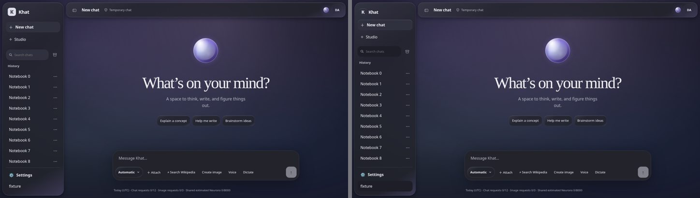
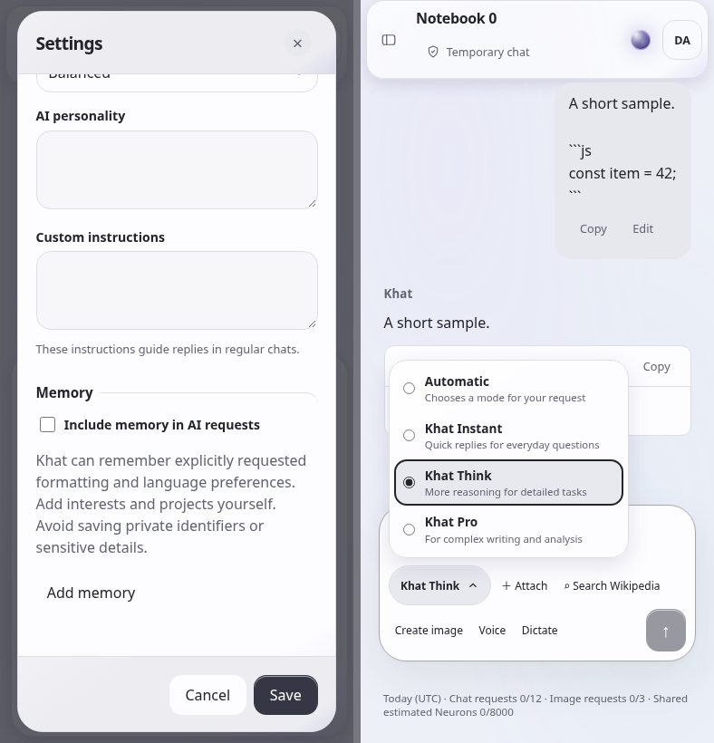

# Product polish and personalization

## Profile and custom instructions

The display name was stored and used in the sidebar, but it never reached the model. The browser sent custom instructions with each chat request and the Worker placed them in optional reference data alongside files and search extracts. The UI also announced Save before the workspace write completed.

Registered accounts now use validated, owner-scoped preferences from D1. The Worker labels the display name as the user's name, separates it from the assistant's name, and puts personalization guidance in the system prompt below the existing safety rules. The prompt says to use an explicit name in the conversation or instructions before falling back to the display name. Files, search extracts, and matched memories remain separate reference data. Local profiles still send their preferences in normal chat. Save waits for the workspace write before confirming success.

## Chat privacy

Normal chats use the saved profile name and instructions, AI name, personality, response style and length. With memory enabled, they can use relevant memories and store supported explicit preferences. These chats appear in history.

Temporary chats use the selected model, interface language, the conversation in progress, and any tools or attachments explicitly used in that chat. They skip the saved name, instructions, AI personality and memories. They neither save the conversation to history nor create memories. The interface explains this and the Worker skips the personalization and memory reads.

## Visual verification

Chromium covered 390, 768, 1024, 1280 and 1440 px with light and dark themes, custom accent changes, sidebar toggles, temporary chat, model switching, composer send, and Settings Save and Cancel. The Worker regression test sends “hvad er mit navn?” through the chat route with account preferences containing “Mit navn er tjek.” It checks the actual prompt passed to the AI binding for both normal and temporary chats. The provider response is simulated, so wording from the live Cloudflare model remains unverified. The Linux environment could not launch Playwright WebKit because it lacks system libraries, so native Safari and iOS remain unverified.

### Desktop before and after

### Mobile Settings and models

