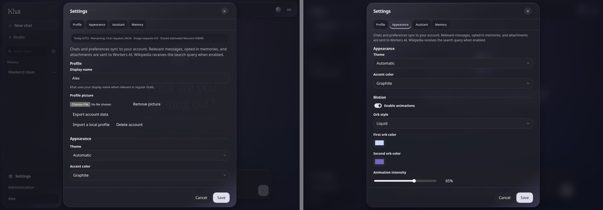
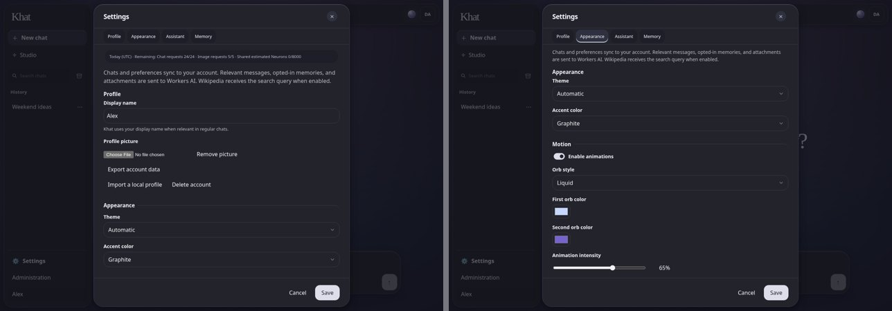

# Settings audit

The four keyboard-accessible tabs preserve one unsaved draft. Save commits once, reports success after storage confirms it, and keeps the draft open on failure. Escape and Cancel discard the draft and restore the saved appearance.

| Setting | Previous behavior | Decision and verification |
| --- | --- | --- |
| Display name | Stored per account and read by the inference worker | Retained. Account browser smoke saves it, Worker tests verify it is sent only to eligible chat. |
| Picture upload / remove | Stored in owner-scoped preferences | Retained. Upload is styled and Remove is conditional. Account smoke checks stored JPEG. Remove visibility was inspected in the browser. |
| Export / deletion | Existing authenticated flows | Retained, with separate deletion section. Account suite tests authorization, export and deletion. |
| Import local profile | Supports migration of encrypted local profiles | Retained to preserve migration. Legacy browser migration test passed. |
| Theme and accent | Applied via root appearance and persisted | Retained. Browser suite checks dark, automatic and custom accent. |
| Surface style | Applied globally; Glass dialog clamped to at least 93% opacity | Retained. Settings uses the slider value as background alpha and keeps text opaque. Browser checks distinct computed colors, Solid and Cancel. |
| Glass blur | Settings backdrop capped at 12 px, UI allowed 24 px | Retained. Settings and its swatch reflect the full range when browser supports Glass. Browser checks 24 px and no blur in Solid. |
| Animation toggle / orb style / orb colors | Applied via CSS and account preferences | Retained. Account browser exercises toggle, style and first color. Second color uses the same preference pipeline and was not individually toggled by automation. |
| Animation intensity / text size / background | Applied via root variables and attributes | Retained, with numeric readouts for ranges. Existing implementation traced. These settings were not individually tested on Safari or on two devices. |
| Orb glow, speed, detail, size / density | Niche effects with overlapping controls | Removed from Settings. Stored values remain readable and round-trip on save. |
| Visual reset | Reset appearance draft only | Retained. Uses visible appearance control defaults. Legacy hidden preferences are preserved. |
| Editable AI name | Applied to message labels and inference | Removed from UI and inference. Assistant is Khat. Existing stored names are preserved. |
| Personality / custom instructions | Separate text fields with overlapping purpose | Consolidated. Previously stored text is shown together and becomes one canonical instruction field on Save. Browser draft and Worker personalization tests cover the flow. |
| Response length / style | Applied to prompt and length also to token cap | Retained. Legacy browser checks selection and request; Worker tests inspect prompt payload. Live model output not verified. |
| Memory enable | Owner-scoped opt-in; temporary bypass | Retained with explicit explanation that disabling preserves entries. Worker tests verify relevant reads and temporary isolation. |
| Add / edit / delete individual memory | Staged in the settings draft | Retained. Account browser tests opt-in and memory storage; individual edit/delete were not separately asserted. |
| Clear all memories | Legacy text clear only | Added confirmation for both profile types. Browser test covers the legacy confirmation. Account clear-all shares the same draft handler. |

No database migration or Cloudflare configuration change is required. Native Safari and live-model responses were not tested.

## Appearance before and after

Earlier version on the left.

