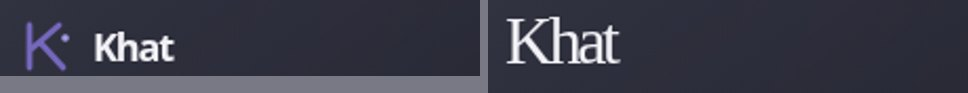
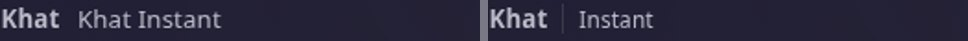
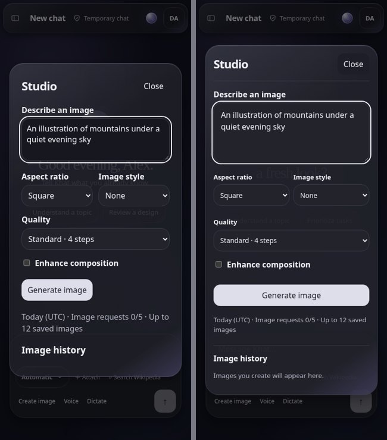
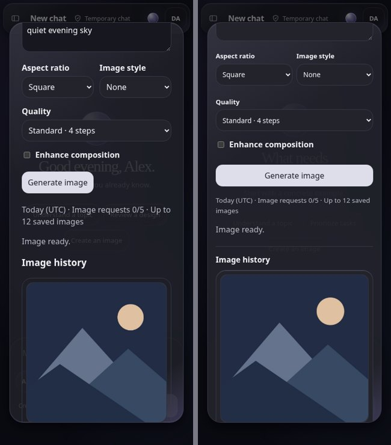
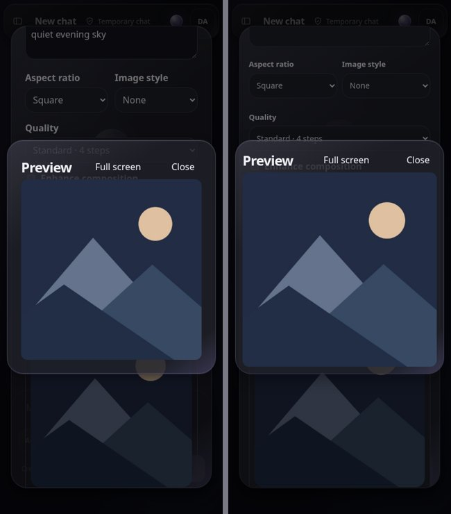

# Khat wordmark and Studio finish

The sidebar uses a standalone typographic Khat wordmark. The tab title remains Khat and the compact favicon remains in the browser chrome. Assistant headers use the assistant name followed by a distinct model label such as Instant, Think or Pro.

Studio uses a larger prompt field, grouped aspect ratio, style and quality controls, a clearer submit area, dedicated feedback, and captions with grouped result actions. The temporary composer and sidebar Studio actions now open the session-only Studio view.

With Enhance composition selected, the original prompt is screened first. Gemma then rewrites it as a short English visual prompt with explicit spatial relationships. Studio screens the rewritten version before sending it to FLUX and screens the returned image. If the rewriter is unavailable or returns no usable text, Studio falls back to the already screened original. The estimate for enhanced requests reserves 600 Neurons against the existing shared budget. The regular option retains its 500-Neuron estimate. No new binding is required.

The regression test uses the Danish monkey, phone and banana prompt and checks the exact input sent to FLUX using a mocked rewrite. Another test verifies that a blocked rewrite prevents generation. The live model's ability to depict the banana on the screen remains unverified. Studio regeneration uses the current form options, as it did before.

Verification covered 45 automated tests, the Wrangler dry run, the Chromium application smoke suite, and before-and-after Studio interactions at 390 and 1280 px with a fixture image. Native Safari remains unverified. A useful follow-up is to compare a small live sample with enhancement enabled and disabled.

## Before and after

Screenshots place the previous version on the left. The result is a fixture illustration.

