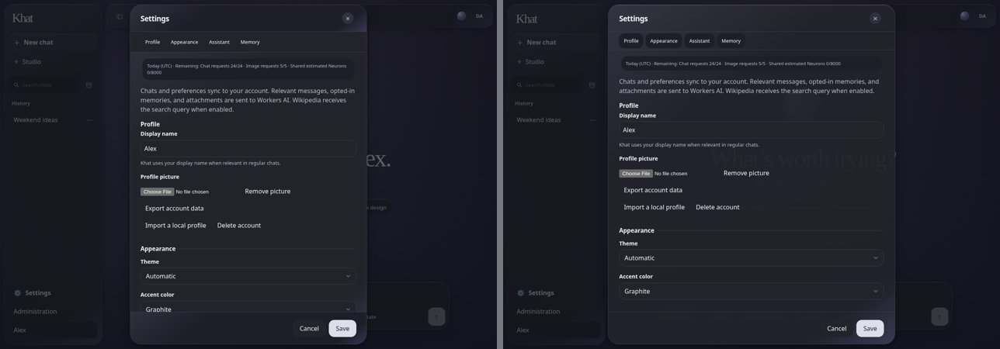
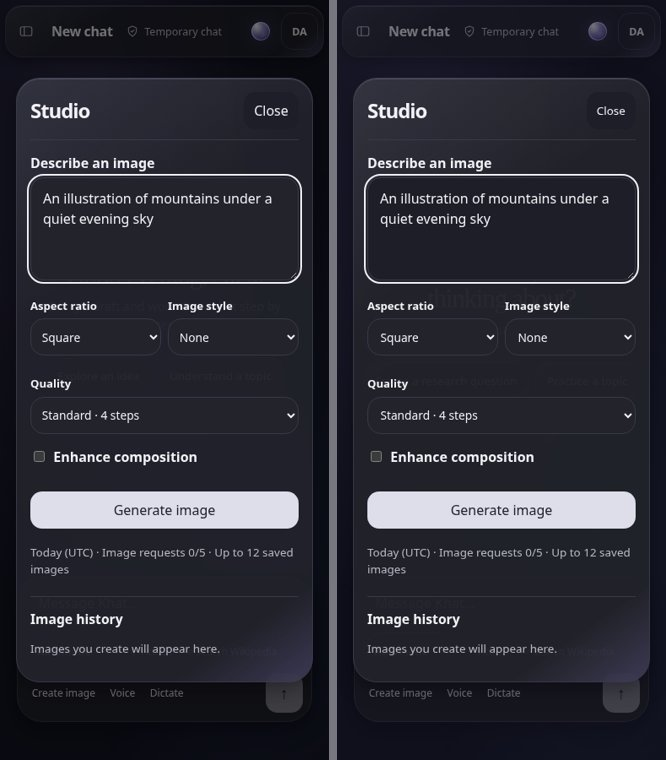
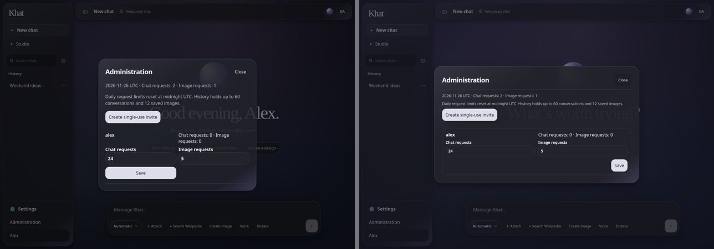
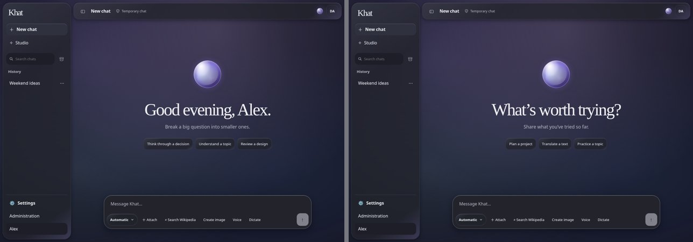

# Unified surfaces

Appearance now applies the saved Liquid Glass or Solid choice to dialogs, the sidebar, composer, navigation and model menu. The existing sidebar material preference is reused so the selection carries over between devices without a migration. Glass shares fill, highlight, shadow and backdrop treatments. Solid removes translucency and backdrop blur while keeping the same layout. Accessibility preferences and browser capability can select a lighter fallback.

Settings, Studio and Administration share the main modal width, spacing and radius. Administration groups usage and invitation controls above the account rows. Studio groups picture actions and retains the existing safety checks. The optional rewrite now instructs Gemma to clarify framing and lighting for vague requests while preserving objects, counts and relationships.

The existing authenticated D1 profile and instructions remain the source for normal chat. Prompt guidance now distinguishes the assistant name from the user's display name, explains when to use it and includes natural Danish spelling examples. Temporary Chat continues to skip those saved preferences. Rotating welcome suggestions now include summarizing, practice and translation.

Chromium captured desktop and mobile fixture screens and checked Solid and Cancel. Automated Worker tests cover the saved-data path and image safety checks. Native Safari and live Danish and image-model output were not verified.

## Before and after

The earlier version is on the left. Studio and Administration use fixture data.

